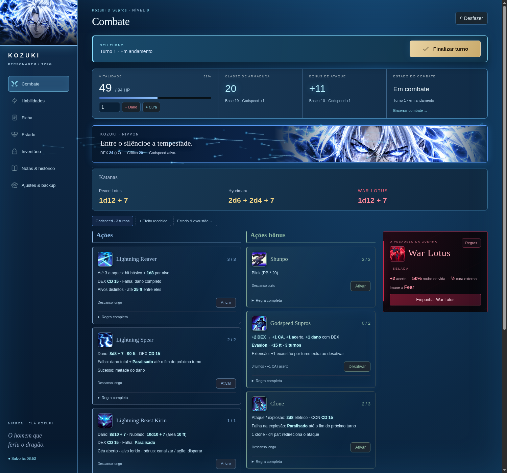

# RPG Interactive Character Sheet

**Uma ficha interativa para acompanhar seu personagem durante sessões presenciais de RPG.**

Controle vida, cargas, turnos, equipamentos e anotações em uma interface local com identidade visual própria. Transformações e habilidades ganham vida com partículas, raios e cenas animadas em PixiJS.

A versão atual foi construída para **Kozuki D Supros**, personagem de uma campanha com regras próprias. Os valores e várias descrições podem ser editados na interface; as automações de combate ainda são específicas desse personagem.



*Combate com Godspeed ativo: recursos, controle de turno, habilidades por categoria e painel da War Lotus.*

[Começar a usar](#começar-a-usar) · [Tutorial](#tutorial-de-uso) · [Levar ao notebook](#levar-sua-partida-para-outro-dispositivo) · [Desenvolvimento](#desenvolvimento)

## O que o projeto oferece

| Recurso | Como ajuda durante a sessão |
| --- | --- |
| Combate | Vida, CA, acerto, dano das armas e controle do turno individual em uma tela. |
| Habilidades | Catálogo com regras, usos, recargas, consulta e edição. |
| Categorias visuais | Ações em azul, ações bônus em verde, reações em laranja, passivas em dourado e ações livres em branco. |
| Transformações | Godspeed e War Lotus atualizam os derivados implementados, a paleta e os efeitos visuais. |
| Estado | Exaustão, efeitos recebidos, modificadores temporários e lembretes. |
| Ficha e inventário | Atributos, salvaguardas, perícias, equipamentos e quantidades. |
| Notas e histórico | Diário da campanha, registro de operações e opção de desfazer. |
| Salvamento local | Dados persistidos no navegador, com exportação e importação de backup JSON. |
| Funcionamento offline | Depois de baixar o projeto, os arquivos e a biblioteca visual ficam disponíveis localmente. |

A ficha foi feita para acompanhar a mesa: **os dados são rolados fisicamente**. Fórmulas, CDs e bônus ficam visíveis; ataques, condições sobre inimigos e decisões do mestre continuam sendo resolvidos pelos jogadores.

## Começar a usar

### 1. Confira os requisitos

- **Python 3**, disponível no terminal.
- Um navegador atual. Os efeitos PixiJS usam **WebGL**.
- **Git**, somente se preferir clonar e atualizar pelo terminal.

Não é necessário instalar Node.js, executar `npm install` ou fazer build para jogar. Node.js é usado apenas nos testes de desenvolvimento.

### 2. Baixe o projeto

**Pelo GitHub:** clique em **Code → Download ZIP** e extraia o arquivo antes de iniciar.

**Pelo terminal:**

```bash
git clone https://github.com/ViolanteGabriel/rpg-interactive-character-sheet.git
cd rpg-interactive-character-sheet
```

Nos próximos comandos, use a pasta principal do projeto — a que contém este README e a pasta `InterctivePlayerSheet`.

### 3. Inicie o servidor local

**Linux ou macOS:**

```bash
bash InterctivePlayerSheet/iniciar-ficha.sh
```

**Windows:** abra `InterctivePlayerSheet/iniciar-ficha.bat` com dois cliques, ou execute no terminal:

```powershell
py -3 .\InterctivePlayerSheet\iniciar-ficha.py
```

Se o comando do Python na sua instalação for `python`, use:

```bash
python InterctivePlayerSheet/iniciar-ficha.py
```

### 4. Abra a ficha

Acesse **[http://localhost:8765](http://localhost:8765)** e mantenha o terminal do servidor aberto enquanto joga. Para encerrá-lo, pressione **Ctrl+C** no terminal.

Use sempre **`http://localhost:8765`**, no mesmo perfil do navegador. `localhost` e `127.0.0.1` têm armazenamentos separados. Abra a ficha pelo servidor local, em vez de abrir `index.html` diretamente.

## Tutorial de uso

### 1. Conheça a ficha e ajuste os valores

Na primeira execução, o aplicativo carrega a ficha inicial do Supros. Depois disso, restaura os dados salvos neste navegador.

- Em **Ficha**, consulte e edite atributos, salvaguardas e perícias.
- Em **Habilidades**, use **Consultar** para ler a regra e **Editar** para ajustar os campos disponíveis.
- Em **Inventário**, revise equipamentos e quantidades.
- Em **Ajustes & backup**, confira os valores base do personagem e as configurações da War Lotus.

As automações disponíveis seguem as regras atuais do Supros; editar um texto não cria uma nova automação de combate.

### 2. Acompanhe um combate

1. Na seção **Combate**, clique em **Iniciar combate**.
2. Quando chegar sua vez, clique em **Iniciar turno** na barra destacada.
3. Consulte os números das armas e as habilidades, organizadas pelo tipo de ação.
4. Use **Ativar** na habilidade desejada. A ficha registra os recursos e estados implementados.
5. Informe a quantidade de dano ou cura e use os controles de vida quando necessário.
6. Clique em **Finalizar turno** para avançar os efeitos ligados a esse marco.
7. Ao terminar o encontro, use **Encerrar combate** e confira as decisões de encerramento apresentadas pela ficha.

Os descansos ficam em **Habilidades** e mostram uma prévia antes da confirmação. Encerrar o servidor ou fechar o navegador não recupera vida, cargas ou turnos.

### 3. Use as habilidades e transformações

| Habilidade | Comportamento implementado |
| --- | --- |
| Godspeed | Ativação durante o turno, bônus derivados de DEX, duração, extensão e exaustão. Partículas e descargas branco-azuladas acompanham a transformação. |
| War Lotus | Sacrifício informado por d100 físicos, dívida, bônus e cura. Descargas negras aparecem ao empunhar; embainhar com Godspeed ativo restaura sua apresentação. |
| Kirin | **Canalizar** e **Disparar** são etapas distintas. A carga é consumida na canalização; o disparo não consome uma segunda carga. A cena reúne o céu, a fera elétrica, a descarga e o impacto. |
| Parry e Clone | Estados próprios com controles de acompanhamento e encerramento. |

Para detalhes mecânicos e duração dos efeitos, consulte [o guia de combate](InterctivePlayerSheet/COMBATE.md).

### 4. Registre efeitos e anotações

- Em **Estado**, registre efeitos recebidos, seus modificadores, duração e exaustão.
- Em **Notas & histórico**, mantenha o diário e consulte as operações recentes.
- Use os botões **Salvar** nos formulários do diário e dos lembretes livres.
- Use **Desfazer** para reverter a última operação registrada, quando disponível.

### 5. Experimente os efeitos sem gastar recursos

Com o servidor ligado, abra as prévias independentes:

- **[Godspeed](http://localhost:8765/godspeed-preview.html)** — ativação, impulso e fluxo de partículas.
- **[War Lotus e Kirin](http://localhost:8765/combat-preview.html)** — descargas negras, canalização e disparo.

Essas páginas não leem nem gravam a partida. Também estão acessíveis por **Ajustes & backup**.

As animações respeitam a preferência de movimento reduzido do sistema. Você também pode desligá-las em **Ajustes & backup → Efeitos visuais**.

## Levar sua partida para outro dispositivo

**O repositório guarda o aplicativo. A partida fica no navegador e precisa ser transferida por backup.** Não há sincronização automática entre computadores.

### No computador de origem

1. Salve o diário e os lembretes que estiver editando.
2. Abra **Ajustes & backup → Backup completo**.
3. Clique em **Exportar JSON**.
4. Copie o arquivo exportado para o outro dispositivo por um meio de sua escolha.

### No notebook ou computador de destino

1. Baixe este projeto e inicie o servidor local conforme o tutorial acima.
2. Abra **http://localhost:8765**.
3. Em **Ajustes & backup → Backup completo**, clique em **Importar backup**.
4. Selecione o JSON exportado, confira a prévia e confirme a importação.
5. Verifique vida, cargas, notas e turno antes de continuar a sessão.

Ao voltar a jogar no computador anterior, exporte o estado mais recente do notebook e importe-o naquele computador. A importação substitui o estado atual após confirmação e guarda uma cópia anterior internamente.

Guarde seus backups fora do navegador. Limpar os dados do site ou usar outro perfil não transfere a partida. Evite usar navegação anônima para mantê-la entre sessões.

## Atualizar o aplicativo

Se você clonou o projeto com Git, exporte um backup da partida e execute na pasta principal:

```bash
git pull --ff-only
```

Se baixou o ZIP, extraia a versão mais recente em uma pasta e inicie o servidor dessa versão. Encerre o servidor anterior antes de iniciar outro na mesma porta.

Recarregue a página depois da atualização. Usar o mesmo endereço e perfil do navegador preserva o armazenamento local; os arquivos do projeto não contêm o estado atual da sua sessão.

## Solução de problemas

| Situação | O que conferir |
| --- | --- |
| `python` ou `py` não encontrado | Instale Python 3 e habilite seu acesso pelo terminal; abra um novo terminal após a instalação. |
| Porta 8765 ocupada | Confira se a ficha já está em execução. Use o servidor existente ou encerre-o no terminal original antes de iniciar outro. |
| Ficha aparece com valores iniciais | Confira o endereço e o perfil do navegador. Para continuar em outro dispositivo, importe o backup. |
| Ficha em modo somente leitura | Outra aba mantém o bloqueio de edição. Feche a outra aba e recarregue a que deseja usar. |
| Efeitos não aparecem | Confira **Efeitos visuais**, a preferência de movimento reduzido do sistema e a disponibilidade de WebGL no navegador. |
| Alterações visuais antigas continuam aparecendo | Recarregue a página; se necessário, faça uma recarga completa com `Ctrl+Shift+R` (`Cmd+Shift+R` no macOS). |

## Desenvolvimento

O aplicativo usa **HTML, CSS e módulos JavaScript**, com **IndexedDB** para persistência e **PixiJS 8.22.0** para os novos efeitos visuais. O servidor usa apenas a biblioteca padrão do Python.

### Executar os testes

Com **Node.js 20 ou mais recente**:

```bash
cd InterctivePlayerSheet/app
npm test
```

O runner de testes é nativo do Node.js, sem instalação de dependências. Os testes cobrem regras, migrações, recursos, agrupamento de habilidades, transformações e geometria/cronologia dos novos efeitos.

### Estrutura do projeto

```text
InterctivePlayerSheet/
├── iniciar-ficha.py          # Servidor local multiplataforma
├── iniciar-ficha.sh          # Inicializador Linux/macOS
├── iniciar-ficha.bat         # Inicializador Windows
└── app/
    ├── index.html            # Estrutura da interface
    ├── app.mjs               # Renderização, eventos e formulários
    ├── character.json        # Ficha inicial do personagem
    ├── core.mjs              # Validação, migração e operações gerais
    ├── battle.mjs            # Regras e estados de combate
    ├── store.mjs             # IndexedDB
    ├── visuals.mjs           # Integração entre estado e apresentação
    ├── godspeed-fx.mjs       # Partículas e descargas de Godspeed
    ├── combat-fx.mjs          # Efeitos War Lotus e Kirin
    ├── fx-geometry.mjs        # Caminhos e cronologia visual
    ├── assets/               # Retratos, ícones e sprite de Kirin
    ├── vendor/pixi/          # Biblioteca local e licença MIT
    └── tests/                # Testes automatizados
externalAssets/              # Assets originais fornecidos pelo jogador
docs/images/                 # Imagens de apresentação
```

O nome histórico da pasta `InterctivePlayerSheet` foi mantido nos caminhos do projeto.

### Documentação complementar

- [Guia detalhado da ficha](InterctivePlayerSheet/README.md)
- [Regras e operação de combate](InterctivePlayerSheet/COMBATE.md)
- [Estado do desenvolvimento e próximos passos](InterctivePlayerSheet/CONTEXTO_E_PROXIMOS_PASSOS.md)

### Bibliotecas e arte

PixiJS é distribuído localmente com sua [licença MIT](InterctivePlayerSheet/app/vendor/pixi/LICENSE). Os assets originais estão em `externalAssets/`; as cópias usadas pela aplicação ficam em `app/assets/`. A procedência do sprite de Kirin está documentada em [assets/fx](InterctivePlayerSheet/app/assets/fx/README.md).
